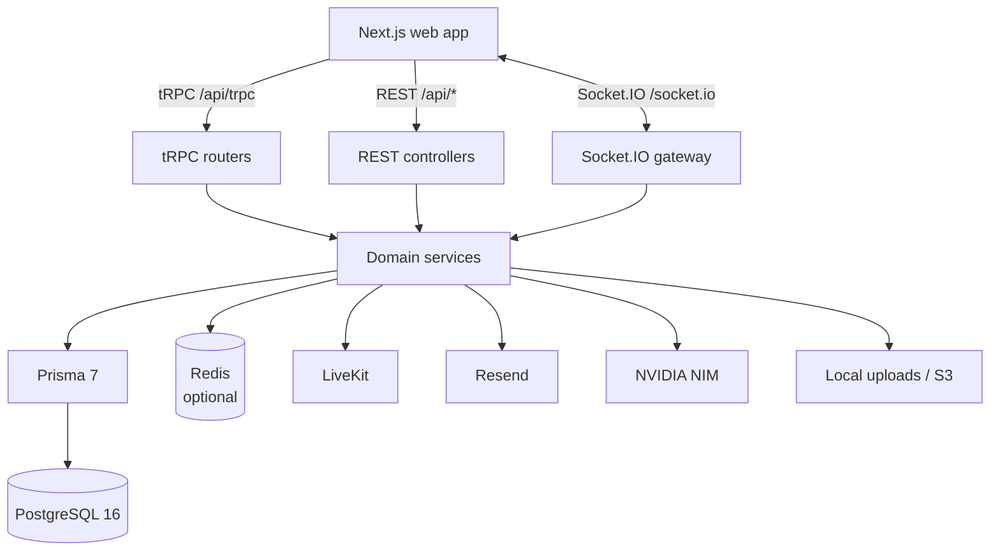

<div align="center">
  
</div>

<h1 align="center">Telehealth App API</h1>

<p align="center">
  NestJS backend for appointments, video consultations, medical records, real-time messaging, and role-based administration.
</p>

<p align="center">
  <a href="https://github.com/leodyversemilla07/telehealth-app/actions/workflows/ci.yml"></a>
  <a href="https://github.com/leodyversemilla07/telehealth-app/actions/workflows/e2e.yml"></a>
  
  
  
</p>

> [!NOTE]
> This API is the backend for the WC Launchpad Builder Round MVP. It covers the full patient, doctor, and admin flows, but formal privacy, regulatory, and data-residency review is still required before it handles real patient data.

## Overview

The API is a NestJS 12 application on Express 5. It owns authentication, role-based access control, appointment scheduling, availability, video consultation tokens, medical documents, clinical records, prescriptions, chat, notifications, AI-assisted specialty recommendations, consent tracking, audit logs, and administrative operations.

Two HTTP surfaces share one NestJS dependency-injection container, the same services, and the same Better Auth session:
- **tRPC** at `/api/trpc` for domain modules with shared Zod contracts and end-to-end types.
- **REST** at `/api/*` for authentication, streaming, multipart uploads, third-party callbacks, and modules that are not yet migrated.

This is a deliberate migration state, not two separate applications. A service is written once and exposed through whichever boundary fits the module.

## Architecture



### Why both tRPC and REST?

| Surface | Best for                                                                                | Examples                                                    |
| ------- | --------------------------------------------------------------------------------------- | ----------------------------------------------------------- |
| tRPC    | Typed domain queries and mutations consumed by `apps/web`                               | Appointments, availability, doctors, records, notifications |
| REST    | Auth, file streaming, multipart uploads, third-party integrations, and admin operations | Better Auth, documents, video, chat, admin, push            |

Both surfaces enforce the same authorization rules. tRPC procedures declare `meta.roles` and run `AuthMiddleware` plus `RolesMiddleware`; REST controllers use Better Auth's `@Roles` decorator and the global `Require2FaInterceptor`. Privileged roles (`DOCTOR`, `ADMIN`) must have 2FA enabled before reaching protected endpoints on either surface.

### Request lifecycle

1. `main.ts` loads the workspace-root environment **before any other import**, then calls `createApp()`.
2. `createApp()` installs Helmet, CORS, the global exception filter, request IDs, the 2FA interceptor, validation, Swagger (non-production), and Socket.IO.
3. REST requests pass through the global `/api` prefix and the throttler, which uses Redis when configured.
4. tRPC requests pass through throttle, logging, and domain-error middleware before the procedure's auth and role middleware.
5. Errors are normalized to `{ statusCode, timestamp, path, requestId, message, error, code, details? }`.

## Tech stack

| Area             | Technology                                                              |
| ---------------- | ----------------------------------------------------------------------- |
| Framework        | NestJS 12, Express 5                                                    |
| Language         | TypeScript 6                                                            |
| RPC              | tRPC 11 via `nestjs-trpc`                                               |
| Validation       | Zod (tRPC contracts, environment), class-validator (REST DTOs)          |
| Database         | PostgreSQL 16, Prisma 7 with `@prisma/adapter-pg`                       |
| Auth             | Better Auth 1.7 — email/password, verification, TOTP 2FA, lockout, RBAC |
| Real-time        | Socket.IO with an optional Redis adapter                                |
| Video            | LiveKit server SDK                                                      |
| Email            | Resend                                                                  |
| AI               | NVIDIA NIM                                                              |
| Storage          | Local filesystem or private S3                                          |
| Cache and limits | Redis (optional in development, required for multiple instances)        |
| Observability    | Pino, request IDs, health check                                         |
| Docs             | Swagger / OpenAPI in non-production                                     |
| Testing          | Jest 30, Supertest, real-Postgres e2e                                   |

## Project structure

```text
apps/api/
├── src/
│   ├── app.controller.ts       # GET /api health check with database latency
│   ├── app.module.ts           # Root module and global providers
│   ├── app.service.ts          # Health payload
│   ├── create-app.ts           # App factory: middleware, CORS, Socket.IO, uploads gate
│   ├── main.ts                 # Environment load + bootstrap
│   ├── admin/                  # User, doctor, dashboard, and report operations
│   ├── appointments/           # Booking lifecycle, reminders, tRPC router
│   ├── audit-logs/             # Audit trail queries
│   ├── auth/                   # Better Auth instance wired to Prisma and email
│   ├── availability/           # Weekly schedule, time off, public slots
│   ├── chat/                   # Conversation and message REST endpoints
│   ├── common/                 # Filters, interceptors, middleware, cache, email, errors
│   ├── config/                 # Env schema, Swagger, throttler
│   ├── consent/                # Privacy consent records
│   ├── doctors/                # Registration, profiles, public search
│   ├── documents/              # Upload, listing, authorized streaming
│   ├── notifications/          # Notification CRUD, preferences, Socket.IO service
│   ├── patients/               # Patient profile
│   ├── prisma/                 # PrismaService over @telehealth/db
│   ├── push/                   # Web Push subscriptions
│   ├── recommendations/        # NVIDIA NIM specialty and symptom analysis
│   ├── records/                # Consultations, records, prescriptions
│   ├── redis/                  # Throttler storage, cache, Socket.IO adapter
│   ├── retention/              # Daily retention purge and PRC re-verification
│   ├── reviews/                # Doctor reviews and ratings
│   ├── security-alerts/        # User-facing security alerts
│   ├── storage/                # Local and S3 storage providers
│   ├── trpc/                   # tRPC module, middlewares, generated contract
│   ├── users/                  # Profile, avatar, sessions, account deletion
│   └── video/                  # LiveKit room tokens
├── test/                       # HTTP e2e and real-database e2e suites
└── uploads/                    # Local storage root (development)
```

Domain modules keep their tRPC router, Zod contracts, service, and REST controller together. The generated tRPC contract lives in `src/trpc/generated/server.ts` and is consumed by the web app through the `api/app-router` export.

## API surface

### tRPC — `/api/trpc`

Routers live beside their domain as `*.router.ts`. Zod contracts in `*.contracts.ts` are the single source of truth for inputs. Global middleware runs in this order: throttle → logging → domain error. Auth and role middleware are applied per procedure.

| Router          | Procedures                                                                                                                      |
| --------------- | ------------------------------------------------------------------------------------------------------------------------------- |
| `appointments`  | `create`, `findMine`, `findUpcoming`, `findHistory`, `findOne`, `updateStatus`, `cancel`, `reschedule`, `sendReminders` (admin) |
| `availability`  | `setAvailability`, `getMyAvailability`, `addTimeOff`, `getTimeOff`, `deleteTimeOff`, `getAvailableSlots`, `getSchedule`         |
| `doctors`       | `list`, `byId`, `register`, `myProfile`, `updateMyProfile`                                                                      |
| `documents`     | `byAppointment`                                                                                                                 |
| `notifications` | `list`, `unreadCount`, `preferences`, `updatePreferences`, `markAllRead`, `markAsRead`                                          |
| `patients`      | `me`, `updateMe`                                                                                                                |
| `records`       | `create`, `byAppointment`, `myRecords`, `myPrescriptions`, `doctorPatients`, `doctorPatientRecords`                             |
| `reviews`       | `create`, `byDoctor`, `myReviews`, `hasReviewed`                                                                                |

Public procedures include doctor search and detail, available slots, weekly schedules, and reviews by doctor. Everything else requires a session.

After changing a router, regenerate the committed contract:

```bash
pnpm --filter api trpc:generate
```

CI fails when the generated contract drifts from the routers.

### REST — `/api/*`

| Module          | Endpoints                                                                                                                                                                           |
| --------------- | ----------------------------------------------------------------------------------------------------------------------------------------------------------------------------------- |
| Auth            | `/api/auth/*` — Better Auth sign-up, sign-in, verification, password reset, 2FA, session, OAuth                                                                                     |
| Users           | `GET/PATCH /api/users/me`, `POST /api/users/me/avatar`, `GET/DELETE /api/users/me/sessions`, `DELETE /api/users/me`, `GET /api/users/public`                                        |
| Video           | `POST /api/video/join`, `POST /api/video/end`                                                                                                                                       |
| Chat            | `POST /api/chat/send`, `GET /api/chat/conversations`, `GET /api/chat/conversation/:userId`, `POST /api/chat/read/:senderId`, `GET /api/chat/unread-count`, `GET /api/chat/contacts` |
| Documents       | `POST /api/documents`, `GET /api/documents/appointment/:appointmentId`, `GET /api/documents/patient/me`, `GET /api/documents/:id/file`                                              |
| Recommendations | `POST /api/recommendations`, `POST /api/recommendations/symptoms`                                                                                                                   |
| Consent         | `POST /api/consent`, `GET /api/consent`                                                                                                                                             |
| Push            | `GET /api/push/vapid-public-key`, `POST/DELETE /api/push/subscribe`                                                                                                                 |
| Security alerts | `GET /api/users/me/security-alerts`, `POST /api/users/me/security-alerts/read`                                                                                                      |
| Audit logs      | `GET /api/audit-logs`                                                                                                                                                               |
| Admin           | `GET /api/admin/dashboard`, `GET /api/admin/reports`, `GET /api/admin/users`, `PATCH /api/admin/users/:id`, ban/unban, role changes, doctor approval, rejection, verification       |
| Health          | `GET /` and `GET /api` — uptime, version, and database latency                                                                                                                      |

Swagger is served at **http://localhost:3001/api/docs** outside production, with JSON and YAML at `/api/docs.json` and `/api/docs.yaml`.

## Authentication and authorization

Authentication is delegated to [Better Auth](https://www.better-auth.com/) in `packages/auth`, configured for the API in `src/auth/auth.ts`.
- Email/password sign-up with **required email verification**
- TOTP two-factor authentication with backup codes
- Account lockout after **5 failed sign-in attempts** for **15 minutes**
- Password rules: 8–128 characters, upper, lower, number, and special character
- Sessions expire after 7 days by default and rotate every 24 hours
- HTTP-only, `SameSite=Lax` cookies; `Secure` in production
- Optional Google and Apple OAuth, enabled only when both provider credentials are present
- Three roles: `PATIENT`, `DOCTOR`, `ADMIN`

Privileged roles must enable 2FA before using doctor or admin endpoints. This is enforced by `Require2FaInterceptor` for REST and `RolesMiddleware` for tRPC, so it cannot be bypassed by calling the other surface.

Additional safeguards:
- Global rate limit of **30 requests per 60 seconds per IP**, backed by Redis when configured
- Stricter limits on costly routes: AI recommendations (10/min), chat send (30/min), avatar upload (5/hour)
- Helmet CSP, HSTS, frame denial, and MIME sniffing protection
- Exact-match CORS allowlist with credentials
- Trusted proxy handling for one reverse-proxy hop
- Audit logs for sensitive actions and security-alert emails for suspicious sign-ins

## Database

The schema, migrations, seed, and shared Prisma client live in `packages/db`:
- Schema: `packages/db/prisma/schema.prisma`
- Migrations: `packages/db/prisma/migrations`
- Generated client: `packages/db/generated/prisma`, re-exported through `@telehealth/db`

There are 21 models across five areas:
- **Auth:** `User`, `Session`, `Account`, `Verification`, `twoFactor`
- **Profiles:** `PatientProfile`, `DoctorProfile`, `AvailabilitySchedule`, `TimeOff`
- **Care:** `Appointment`, `Consultation`, `Prescription`, `MedicalDocument`
- **Communication:** `Notification`, `NotificationPreference`, `PushSubscription`, `ChatMessage`
- **Security and quality:** `ConsentLog`, `AuditLog`, `SecurityAlert`, `Review`

Common database commands, from the repository root:

```bash
pnpm migrate        # prisma migrate deploy
pnpm db:reset       # reset, migrate, and seed
pnpm seed           # seed demo data only
pnpm db:studio      # Prisma Studio
```

The Prisma client uses `@prisma/adapter-pg`, which is compatible with PgBouncer-style connection poolers. `DATABASE_SSL_CA` can supply a PEM certificate for managed PostgreSQL.

## Background jobs

| Schedule       | Job                   | Behavior                                                                                                                  |
| -------------- | --------------------- | ------------------------------------------------------------------------------------------------------------------------- |
| Every hour     | Appointment reminders | Finds appointments in the next 24 hours and sends in-app and email reminders                                              |
| Daily at 02:00 | Retention purge       | Deletes read notifications after 90 days, read security alerts after 730 days, and audit logs after 2,555 days by default |
| Daily at 02:00 | PRC re-verification   | Flags doctors whose Philippine Regulation Commission license is expiring or expired                                       |

Retention windows can be overridden with `RETENTION_NOTIFICATIONS_DAYS`, `RETENTION_SECURITY_ALERTS_DAYS`, and `RETENTION_AUDIT_LOGS_DAYS`.

## File storage

`StorageService` selects a provider at runtime:
- **Local** (default): files live under `apps/api/uploads`. Avatar keys are public and cached immutably; every other key is streamed through the authenticated `/uploads/:key` handler after an ownership check.
- **S3**: set `AWS_REGION`, `AWS_ACCESS_KEY_ID`, `AWS_SECRET_ACCESS_KEY`, and `S3_BUCKET`. Objects stay private and are streamed by the API; no public object URLs are issued.

Uploads are limited to JPEG, PNG, WebP, and PDF, validated by extension, declared MIME type, and magic bytes, with a **10 MB** maximum. The unauthenticated static `/uploads` fallback is mounted only outside production.

## Integrations

| Integration | Behavior when unconfigured                                                                |
| ----------- | ----------------------------------------------------------------------------------------- |
| LiveKit     | `POST /api/video/join` returns `403 Video consultation is not configured`                 |
| NVIDIA NIM  | Recommendation endpoints return `503`                                                     |
| Resend      | The API boots, but verification and reset emails fail                                     |
| Web Push    | The VAPID public key is `null` and push delivery is disabled                              |
| Redis       | In-process rate limits, cache, and Socket.IO adapter; suitable for a single instance only |

AI recommendations strip PII before sending symptoms to NVIDIA NIM. Chat messages are sanitized with `isomorphic-dompurify` before storage.

## Environment variables

The API loads the workspace-root `.env` and `.env.local` through `@telehealth/env/load` as its first import. There are no per-app environment files. The full Zod schema is in `src/config/env.validation.ts`; invalid values fail the boot.

| Variable                                                                   | Required   | Default                                       | Purpose                                        |
| -------------------------------------------------------------------------- | ---------- | --------------------------------------------- | ---------------------------------------------- |
| `DATABASE_URL`                                                             | Yes        | —                                             | PostgreSQL connection string                   |
| `BETTER_AUTH_SECRET`                                                       | Yes        | —                                             | Auth signing secret, at least 32 characters    |
| `PORT`                                                                     | No         | `3001`                                        | API port                                       |
| `NODE_ENV`                                                                 | No         | `development`                                 | `development`, `production`, or `test`         |
| `BETTER_AUTH_URL`                                                          | No         | `http://localhost:3001`                       | Public API base URL                            |
| `CORS_ORIGIN`                                                              | No         | `http://localhost:3000,http://localhost:3001` | Comma-separated allowed origins                |
| `COOKIE_DOMAIN`                                                            | Production | —                                             | Cross-subdomain session cookie domain          |
| `REDIS_URL`                                                                | No         | —                                             | Shared limits, cache, and Socket.IO adapter    |
| `THROTTLE_LIMIT`                                                           | No         | `30`                                          | Requests per 60-second window                  |
| `RESEND_API_KEY`                                                           | Production | —                                             | Verification, reset, reminder, and alert email |
| `EMAIL_FROM`                                                               | No         | —                                             | Verified sender address                        |
| `SESSION_EXPIRY_SECONDS`                                                   | No         | `604800`                                      | Session lifetime                               |
| `CANCELLATION_WINDOW_HOURS`                                                | No         | `24`                                          | Minimum patient cancellation notice            |
| `GOOGLE_CLIENT_ID` / `GOOGLE_CLIENT_SECRET`                                | No         | —                                             | Enables Google OAuth when both are set         |
| `APPLE_CLIENT_ID` / `APPLE_CLIENT_SECRET`                                  | No         | —                                             | Enables Apple OAuth when both are set          |
| `LIVEKIT_URL` / `LIVEKIT_API_KEY` / `LIVEKIT_API_SECRET`                   | No         | —                                             | Video consultations                            |
| `NIM_API_KEY`                                                              | No         | —                                             | AI recommendations                             |
| `VAPID_PUBLIC_KEY` / `VAPID_PRIVATE_KEY` / `VAPID_SUBJECT`                 | No         | —                                             | Web Push                                       |
| `AWS_REGION` / `AWS_ACCESS_KEY_ID` / `AWS_SECRET_ACCESS_KEY` / `S3_BUCKET` | No         | —                                             | Private S3 storage                             |
| `RETENTION_NOTIFICATIONS_DAYS`                                             | No         | `90`                                          | Notification retention                         |
| `RETENTION_SECURITY_ALERTS_DAYS`                                           | No         | `730`                                         | Security alert retention                       |
| `RETENTION_AUDIT_LOGS_DAYS`                                                | No         | `2555`                                        | Audit log retention                            |

Generate a secret with:

```bash
node -e "console.log(require('crypto').randomBytes(32).toString('base64'))"
```

## Getting started

From the repository root:

```bash
pnpm install
cp .env.example .env   # then fill in DATABASE_URL and BETTER_AUTH_SECRET
pnpm db:reset
pnpm --filter api dev
```

The API listens on **http://localhost:3001** and reloads on changes. Run the web app in a second terminal with `pnpm --filter web dev`.

> [!IMPORTANT]
> The web app proxies `/api/*` to `API_URL`, so keep `API_URL=http://localhost:3001` and leave `NEXT_PUBLIC_API_URL` empty for the default same-origin setup.

## Scripts

Run these from `apps/api` or scope them with `pnpm --filter api <script>`.

| Script          | Description                                      |
| --------------- | ------------------------------------------------ |
| `dev`           | Start NestJS in watch mode                       |
| `build`         | Compile with Nest CLI and rewrite path aliases   |
| `start`         | Run the compiled `dist/main.js`                  |
| `start:prod`    | Production start                                 |
| `lint`          | Biome lint                                       |
| `format`        | Biome check and write                            |
| `format:check`  | Biome check without writing                      |
| `typecheck`     | `tsc --noEmit`                                   |
| `test`          | Jest unit and service tests                      |
| `test:watch`    | Jest in watch mode                               |
| `test:cov`      | Jest with coverage gates                         |
| `test:e2e`      | HTTP e2e with a mocked Prisma client             |
| `test:e2e:db`   | Full-stack e2e against real PostgreSQL and Redis |
| `trpc:generate` | Regenerate the committed tRPC contract           |
| `trpc:watch`    | Regenerate the contract on router changes        |

## Testing

```bash
pnpm --filter api test        # unit and service specs
pnpm --filter api test:cov    # coverage report
pnpm --filter api test:e2e    # HTTP e2e, full AppModule, mocked Prisma
pnpm --filter api test:e2e:db # real PostgreSQL and Redis
```

- **Unit specs** cover services, guards, interceptors, middleware, and utilities.
- **HTTP e2e** boots the full `AppModule` without opening a port, then exercises routes with Supertest.
- **Database e2e** runs against real PostgreSQL and Redis to validate Prisma queries, transactions, and scheduling constraints.
- Coverage thresholds are enforced in Jest configuration so unrelated changes cannot lower the baseline.

The `ci` workflow runs formatting, linting, type-checking, unit tests, coverage, both e2e suites, a tRPC contract drift check, and a production build against PostgreSQL and Redis service containers.

## Operations

- **Health:** `GET /` is a lightweight liveness probe; `GET /api` also checks database connectivity and reports latency.
- **Logging:** Pino structured logs, with a request ID attached to every response as `X-Request-Id`.
- **Errors:** stable machine-readable `code` values from the shared error table, plus `details` for validation failures.
- **Rate limits:** `429` responses include `Retry-After` and `X-RateLimit-*` headers.
- **Swagger:** only mounted when `NODE_ENV !== "production"`.
- **Shutdown:** Nest shutdown hooks close the Prisma pool and Redis connections on `SIGTERM` and `SIGINT`.
- **Proxy:** `trust proxy` is set to exactly one hop. Keep the API port private and expose it through nginx or the platform proxy.
- **Scaling:** configure `REDIS_URL` before running more than one instance so rate limits, cache, and Socket.IO rooms are shared.

> [!WARNING]
> This MVP has not completed formal regulatory, privacy, or security review. Do not store real patient data until those reviews, data-residency decisions, and production hardening are complete.

## Documentation

- [Root README](../../README.md) — monorepo setup, scripts, and shared architecture
- [Web README](../web/README.md) — routes, data fetching, and frontend architecture
- [Software Requirements Specification](../../docs/SRS.md) — product scope, requirements, data model, and route map
- [Design System](../../docs/DESIGN-SYSTEM.md) — color tokens and component usage
- [Prisma schema](../../packages/db/prisma/schema.prisma) — database models and relations
