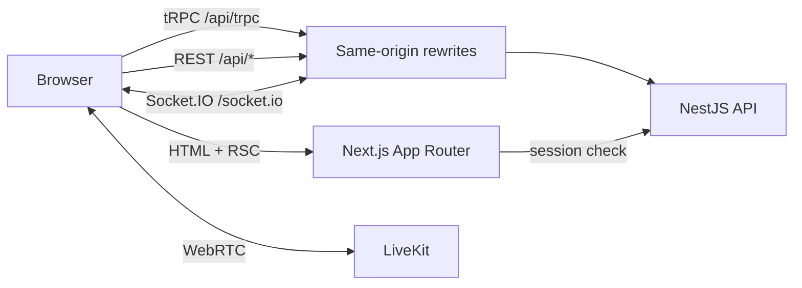

<div align="center">
  
</div>

<h1 align="center">Telehealth App Web</h1>

<p align="center">
  Patient, doctor, and administrator portals for booking, video consultations, records, messaging, and platform administration.
</p>

<p align="center">
  <a href="https://github.com/leodyversemilla07/telehealth-app/actions/workflows/ci.yml"></a>
  <a href="https://github.com/leodyversemilla07/telehealth-app/actions/workflows/e2e.yml"></a>
  
  
  
</p>

> [!NOTE]
> This frontend is part of the WC Launchpad Builder Round MVP. It implements the full patient, doctor, and admin journeys, but formal privacy, regulatory, and accessibility review is still required before production use with real patient data.

## Overview

The web app is a Next.js 16 App Router application built with React 19, Tailwind CSS v4, and Base UI. It provides three authenticated portals behind a shared public site:
- **Patients** discover doctors, book and manage appointments, attend video consultations, chat with their care team, review records and prescriptions, run an AI-assisted symptom check, and manage their profile and privacy settings.
- **Doctors** register with PRC credentials, publish availability, work through consultation queues, chart SOAP notes, issue prescriptions, review patient history, and message patients.
- **Administrators** monitor platform activity, manage users and roles, approve or verify doctors, review audit logs, and inspect operational reports.

The app talks to the NestJS API through same-origin `/api/*` rewrites by default, so session cookies stay first-party and the browser needs no direct API origin.

## Features

### For patients

- Search doctors by name, specialty, and rating
- Get specialty recommendations from the AI symptom checker
- Book appointments against real availability in Philippine Time (PHT)
- Reschedule or cancel within the configured notice window
- Join LiveKit video consultations with a waiting-room overlay
- Leave a rating and review after a completed consultation
- Chat with doctors in real time, with unread counts
- View consultation history, clinical notes, and prescriptions
- Receive in-app, web push, and email notifications
- Manage profile, health details, privacy consent, sessions, and 2FA
- Review security alerts and enable TOTP two-factor authentication

### For doctors

- Register a professional profile with PRC license details
- Publish a public profile after admin approval
- Configure weekly availability, slot duration, and time off
- Work through upcoming and in-progress consultations
- Admit patients to the virtual room and run the call
- Record diagnosis, SOAP notes, and electronic prescriptions
- Review patient history and prior consultation records
- Chat with patients and manage notification preferences
- Enforce 2FA before entering the doctor portal

### For administrators

- Dashboard with user, doctor, appointment, and security metrics
- Search users, change roles, and ban or unban accounts
- Approve, reject, verify, and unverify doctor credentials
- Search audit logs by actor or action and filter by date
- Generate date-range reports for appointments and platform activity
- Review security alerts and manage admin notification preferences
- Enforce 2FA before entering the admin portal

### Platform

- Email/password authentication with required verification
- TOTP two-factor authentication with backup codes
- Server-side route guards before protected pages render
- Role-aware navigation, breadcrumbs, and settings
- Light and dark themes with system preference support
- Responsive layouts for desktop and mobile
- Nonce-based Content Security Policy on document routes
- Web Push with a service worker
- LiveKit video with camera, microphone, and screen-share controls

## Tech stack

| Layer                  | Technology                                               |
| ---------------------- | -------------------------------------------------------- |
| Framework              | Next.js 16.4 App Router, Turbopack                       |
| UI runtime             | React 19.3                                               |
| Language               | TypeScript 6                                             |
| Styling                | Tailwind CSS v4, Base UI primitives from `@workspace/ui` |
| Icons                  | Lucide React                                             |
| Data fetching          | TanStack Query 5, tRPC 11 client, typed REST client      |
| Real-time              | Socket.IO client                                         |
| Video                  | LiveKit Components and `livekit-client`                  |
| Auth                   | Better Auth client SDK                                   |
| Forms and validation   | Shared Zod schemas from `@workspace/shared`              |
| Theming                | `next-themes`                                            |
| Unit testing           | Vitest 5, jsdom, Testing Library                         |
| End-to-end testing     | Playwright 1.64                                          |
| Formatting and linting | Biome 2                                                  |

## Route map

The App Router lives directly under `apps/web/app`; there is no `src/` directory.

### Public

| Route           | Purpose                                                                 |
| --------------- | ----------------------------------------------------------------------- |
| `/`             | Landing page with doctor search, specialties, and symptom-checker entry |
| `/doctors`      | Doctor directory with search, specialty filter, and ratings             |
| `/specialties`  | Specialty catalog and common conditions                                 |
| `/how-it-works` | Patient journey and consultation expectations                           |
| `/about`        | Platform and care-model information                                     |
| `/faq`          | Common questions                                                        |
| `/privacy`      | Privacy policy                                                          |
| `/terms`        | Terms of service                                                        |

### Authentication

| Route              | Purpose                                           |
| ------------------ | ------------------------------------------------- |
| `/sign-in`         | Email/password sign-in with `callbackUrl` support |
| `/sign-up`         | Patient registration with consent capture         |
| `/forgot-password` | Request a password reset email                    |
| `/reset-password`  | Set a new password from a reset token             |

### Patient portal — `/patient/*`

| Route                             | Purpose                                                        |
| --------------------------------- | -------------------------------------------------------------- |
| `/patient/dashboard`              | Upcoming appointments, quick actions, and recent prescriptions |
| `/patient/appointments`           | Appointment list with status filters                           |
| `/patient/appointments/book`      | Doctor, date, and slot selection                               |
| `/patient/appointments/[id]`      | Detail, join call, reschedule, cancel, and review              |
| `/patient/chat`                   | Real-time messaging with doctors                               |
| `/patient/messages`               | Redirect to `/patient/chat`                                    |
| `/patient/records`                | Consultation history and clinical notes                        |
| `/patient/prescriptions`          | Prescription list                                              |
| `/patient/prescriptions/[id]`     | Prescription detail                                            |
| `/patient/symptoms`               | AI symptom analysis and recommended doctors                    |
| `/patient/settings/profile`       | Name, email, and avatar                                        |
| `/patient/settings/health`        | Health details used in care                                    |
| `/patient/settings/privacy`       | Consent and privacy preferences                                |
| `/patient/settings/notifications` | In-app, email, and push preferences                            |
| `/patient/settings/alerts`        | Security alerts                                                |
| `/patient/settings/password`      | Password change                                                |
| `/patient/settings/two-factor`    | TOTP enrollment and backup codes                               |
| `/patient/settings/sessions`      | Active sessions and revocation                                 |
| `/patient/settings/appearance`    | Light, dark, or system theme                                   |

### Doctor portal — `/doctor/*`

| Route                                   | Purpose                                                 |
| --------------------------------------- | ------------------------------------------------------- |
| `/doctor/register`                      | PRC registration for patients applying as doctors       |
| `/doctor/dashboard`                     | Daily queue, consultation stats, and quick actions      |
| `/doctor/consultations`                 | Upcoming and in-progress consultations                  |
| `/doctor/consultations/[appointmentId]` | Video room, SOAP charting, diagnosis, and prescriptions |
| `/doctor/patients`                      | Patient list derived from consultations                 |
| `/doctor/patients/[patientId]`          | Patient history and prior records                       |
| `/doctor/records`                       | Completed consultation records                          |
| `/doctor/schedule`                      | Weekly availability, slot duration, and time off        |
| `/doctor/chat`                          | Real-time messaging with patients                       |
| `/doctor/settings/profile`              | Name, email, and avatar                                 |
| `/doctor/settings/professional`         | Specialty, bio, PRC license, and consultation fee       |
| `/doctor/settings/notifications`        | Notification preferences                                |
| `/doctor/settings/alerts`               | Security alerts                                         |
| `/doctor/settings/password`             | Password change                                         |
| `/doctor/settings/two-factor`           | TOTP enrollment and backup codes                        |
| `/doctor/settings/sessions`             | Active sessions and revocation                          |
| `/doctor/settings/appearance`           | Theme selection                                         |

### Admin portal — `/admin/*`

| Route                           | Purpose                                     |
| ------------------------------- | ------------------------------------------- |
| `/admin/dashboard`              | Platform metrics and recent activity        |
| `/admin/users`                  | User search, role changes, and bans         |
| `/admin/doctors`                | Doctor approval and PRC verification        |
| `/admin/reports`                | Date-range appointment and platform reports |
| `/admin/audit-logs`             | Audit trail with filters and pagination     |
| `/admin/settings/profile`       | Admin profile                               |
| `/admin/settings/notifications` | Notification preferences                    |
| `/admin/settings/alerts`        | Security alerts                             |
| `/admin/settings/password`      | Password change                             |
| `/admin/settings/two-factor`    | TOTP enrollment and backup codes            |
| `/admin/settings/sessions`      | Active sessions and revocation              |
| `/admin/settings/appearance`    | Theme selection                             |

## Architecture



### Data flow

- **tRPC** is the default for typed domain data. The browser client uses `httpBatchLink` against `/api/trpc` and the shared `dateTransformer`, then exposes TanStack Query options through `useTRPC()`.
- **REST** handles auth, uploads, video tokens, chat, recommendations, push, and admin endpoints. `lib/api-client.ts` unwraps the API envelope, applies timeouts and retries, and throws a typed `ApiError`.
- **TanStack Query** owns caching, invalidation, and optimistic updates. Domain hooks in `hooks/` wrap queries and mutations so pages stay focused on rendering.
- **Server-side helper** `lib/trpc/server.ts` forwards the session cookie to the API for React Server Components and server-side fetching.
- **Socket.IO** shares the same-origin rewrite, authenticates with the session cookie, and invalidates query caches when notifications or chat messages arrive.
- **LiveKit** connects directly from the browser to the media server using a short-lived token issued by `POST /api/video/join`.

### Rendering and security

`proxy.ts` is the Next.js 16 replacement for middleware. It runs before protected pages render and:
1. Generates a per-request CSP nonce and attaches the policy to both the request and response.
2. Calls `/api/auth/get-session` with the browser cookie.
3. Redirects unauthenticated users to `/sign-in?callbackUrl=...`.
4. Redirects users who cross role boundaries back to their own dashboard.
5. Allows patients through to `/doctor/register` only.

The root layout forces dynamic rendering so the nonce is applied to Next.js framework scripts. Doctor and admin layouts also redirect users who have not enabled 2FA to the two-factor settings page.

## Project structure

```text
apps/web/
├── app/
│   ├── (auth)/                 # Sign-in, sign-up, password reset
│   ├── admin/                  # Admin portal
│   ├── doctor/                 # Doctor portal
│   ├── patient/                # Patient portal
│   ├── about/ faq/ ...         # Public pages
│   ├── layout.tsx              # Providers, fonts, theme, toaster
│   └── page.tsx                # Landing page
├── components/                 # Feature and layout components
│   ├── admin/                  # Admin dialogs and tables
│   ├── homepage/               # Landing page sections
│   ├── settings/               # Shared settings forms
│   └── ui primitives re-exported from @workspace/ui
├── e2e/                        # Playwright specs and helpers
├── hooks/                      # TanStack Query and Socket.IO hooks
├── lib/
│   ├── api-client.ts           # Typed REST client
│   ├── auth-client.ts          # Better Auth browser client
│   ├── env.ts                  # Public env validation
│   ├── push.ts                 # Service worker and Web Push
│   └── trpc/                   # Browser and server tRPC clients
├── public/                     # Logo, images, and service worker
├── test/                       # Vitest setup and unit tests
├── next.config.mjs             # Rewrites, image config, security headers
├── proxy.ts                    # CSP and server-side route guards
└── vitest.config.ts            # Unit test and coverage configuration
```

## Getting started

### Prerequisites

- Node.js 24 or newer
- pnpm 12.16.1
- A running API on `http://localhost:3001`
- PostgreSQL for the API, seeded with demo accounts

### Run locally

From the repository root:

```bash
pnpm install
cp .env.example .env
pnpm db:reset
pnpm dev
```

Or start only the web app after the API is running:

```bash
pnpm --filter web dev
```

The app is available at **http://localhost:3000**. Turbopack handles hot reload.

> [!IMPORTANT]
> The default setup keeps `NEXT_PUBLIC_API_URL` empty so all browser requests go to the same origin and are rewritten to `API_URL`. Set `NEXT_PUBLIC_API_URL` only when the API lives on a different origin and CORS is configured for it.

## Environment variables

The web app reads the workspace-root `.env`; there are no per-app files. `next.config.mjs` calls `loadRootEnv()` before Next reads variables, because `NEXT_PUBLIC_*` values are inlined at build time.

| Variable                | Required | Default                 | Purpose                                                      |
| ----------------------- | -------- | ----------------------- | ------------------------------------------------------------ |
| `API_URL`               | No       | `http://localhost:3001` | Server-side API origin for rewrites and session checks       |
| `NEXT_PUBLIC_API_URL`   | No       | empty                   | Browser API origin; empty means same-origin rewrites         |
| `NEXT_PUBLIC_VAPID_KEY` | No       | empty                   | Public key for Web Push subscriptions                        |
| `WEB_URL`               | No       | `http://localhost:3000` | Playwright base URL and cross-origin links                   |
| `LIVEKIT_URL`           | No       | —                       | Added to the CSP `connect-src` for direct WebRTC connections |
| `NODE_ENV`              | No       | `development`           | Enables development CSP exceptions and production HSTS       |

The API's own variables (`DATABASE_URL`, `BETTER_AUTH_SECRET`, `CORS_ORIGIN`, and integrations) are documented in the [API README](../api/README.md).

## Scripts

Run these from `apps/web` or scope them with `pnpm --filter web <script>`.

| Script         | Description                    |
| -------------- | ------------------------------ |
| `dev`          | Start Next.js with Turbopack   |
| `build`        | Production build               |
| `start`        | Serve the production build     |
| `lint`         | Biome lint                     |
| `format`       | Biome check and write          |
| `format:check` | Biome check without writing    |
| `typecheck`    | `tsc --noEmit`                 |
| `analyze`      | Build with the bundle analyzer |
| `test`         | Run Vitest once                |
| `test:watch`   | Run Vitest in watch mode       |
| `test:cov`     | Run Vitest with coverage gates |
| `test:e2e`     | Run Playwright                 |
| `test:e2e:ui`  | Run Playwright in UI mode      |

## Data fetching and state

### tRPC

```ts
const trpc = useTRPC()
const { data } = useQuery(trpc.appointments.findUpcoming.queryOptions({}))
```

The client batches requests to `/api/trpc`, preserves `Date` values with the shared transformer, and shares one `QueryClient` per browser session. Mutations invalidate the relevant query keys, so appointment, notification, and record views update without a reload.

### REST

```ts
const user = await apiClient.get<UserDto>("/users/me")
```

`apiClient` prepends `/api`, attaches credentials, retries idempotent failures with backoff, and surfaces the API's `{ error, code, details }` envelope as `ApiError`.

### Real-time

- `use-notifications` opens a Socket.IO connection and keeps the unread badge in sync.
- `use-chat-socket` invalidates conversation caches on `chat:message`.
- The chat socket handles `session:revoked` by sending the browser to sign-in.
- Web Push registers `public/sw.js` and stores the subscription through `/api/push/subscribe`.

## Video consultations

`components/consultation-room.tsx` dynamically imports LiveKit only on the client, so WebRTC APIs never run during server rendering. It provides:
- Camera, microphone, and screen-share controls
- A patient waiting overlay until the doctor joins
- A doctor-side waiting banner
- Connection-state feedback and disconnect handling
- Automatic redirect to the appointment or consultation list when the call ends

The API issues room-scoped tokens through `POST /api/video/join`; the browser connects directly to the LiveKit server.

## Design system

- Tailwind CSS v4 tokens and global styles come from `@workspace/ui/globals.css`
- Base UI primitives provide accessible dialogs, menus, tabs, and form controls
- Shared components live in `packages/ui` and are re-exported through `@workspace/ui`
- Lucide React supplies outline icons
- `next-themes` handles light, dark, and system modes without a flash
- Fonts are vendored under `app/fonts` to keep builds hermetic
- PHT formatting and shared date helpers come from `@workspace/shared`

See [docs/DESIGN-SYSTEM.md](../../docs/DESIGN-SYSTEM.md) for color tokens and semantic status colors.

## Testing

### Unit and component tests

```bash
pnpm --filter web test
pnpm --filter web test:cov
```

Vitest runs in jsdom with Testing Library. The suite covers dashboards, booking, the symptom checker, consultation room, admin dialogs, API client behavior, shared schemas, and domain hooks. Coverage gates are enforced at 71% statements, 60% branches, 66% functions, and 71% lines.

### End-to-end tests

```bash
pnpm --filter web test:e2e
pnpm --filter web test:e2e:ui
```

Playwright starts both the API and web dev servers, runs Chromium with one worker, and retries twice in CI. Specs cover authentication, the appointment lifecycle, portal navigation, video consultation, and a production smoke path. The demo accounts and TOTP secret come from `packages/db/prisma/seed.ts`.

The `e2e` workflow runs against PostgreSQL and Redis on every pull request, on pushes to `main`, and nightly. The `ci` workflow runs formatting, linting, type-checking, unit tests, coverage, and a production build.

## Deployment

- The included `Procfile` starts the app with `next start --port $PORT`.
- Set the root environment variables in the hosting provider; `API_URL` must be reachable from the Next.js server.
- Keep `NEXT_PUBLIC_API_URL` empty when the web app and API share a domain and the rewrites are active.
- Serve the app behind a proxy that forwards `Host` and `X-Forwarded-Proto` so CSP WebSocket origins and session checks resolve correctly.
- Nonce-based CSP requires dynamic rendering, which the root layout enforces.
- The app can be deployed independently of the API as long as the API URL, database, and optional integrations are available.

> [!WARNING]
> This MVP has not completed formal regulatory, privacy, or security review. Do not use it with real patient data until those reviews, data-residency decisions, and production hardening are complete.

## Documentation

- [Root README](../../README.md) — monorepo setup, scripts, and shared architecture
- [API README](../api/README.md) — backend modules, tRPC and REST surface, and operations
- [Software Requirements Specification](../../docs/SRS.md) — product scope, requirements, and route map
- [Design System](../../docs/DESIGN-SYSTEM.md) — color tokens and component usage
